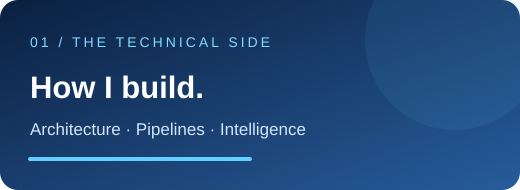
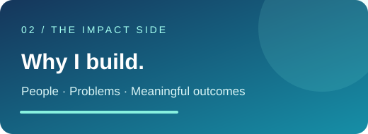

  
    
  
  
    
  

 

## ✦ 01 — The person behind the systems

I'm **Oumayma**, a final-year **Data Engineering student at ENSA Al Hoceima**, curious about the space where thoughtful engineering meets useful innovation.

I enjoy taking a challenge from its first question to its working solution — understanding the problem, designing the architecture, engineering the data, and shaping an experience that makes sense to the people using it.

**My north star:** *Build with technical intention. Deliver meaningful impact.*

## ✦ 02 — Two Sides. One Purpose.

<table><tr><td width="50%" valign="top">  <b>Engineering is the foundation.</b>  I care about the systems behind the result: dependable data pipelines, sound architectures, thoughtful AI integrations, and solutions that can evolve.</td><td width="50%" valign="top">  <b>Usefulness is the destination.</b>  I want technology to make information accessible, help people make decisions, and turn difficult problems into practical experiences.</td></tr></table>

<b>Different perspectives. One direction: build what matters.</b>

## ✦ 03 — Work that connects the two

> Not just what I used — **what I set out to solve, and what I built.**

<table>
<tr><td width="50%" valign="top"><h3>🚕 TaaSim</h3><b>Real-Time Urban Mobility Platform</b>
<b>Challenge</b> — Make high-volume mobility data useful for transportation analysis.

<b>Build</b> — Streaming and geospatial data workflows involving Kafka, Spark, and Flink.
 </td><td width="50%" valign="top"><h3>🌐 Morafiq</h3><b>Multilingual AI Assistant · Voynich SARL</b>
<b>Challenge</b> — Make knowledge easier to access through text and voice.

<b>Build</b> — Built a RAG assistant from scratch, with corpus enrichment, reranking, prompt refinement and LangSmith evaluation.
 </td></tr>
<tr><td width="50%" valign="top"><h3>📚 CDG Knowledge Assistant</h3><b>Document Intelligence · CDG</b>
<b>Challenge</b> — Help users find answers across web pages and PDF documents.

<b>Build</b> — Document-processing pipelines and a RAG chatbot using FAISS, LangChain and Streamlit.
 </td><td width="50%" valign="top"><h3>🧠 Brain Tumor Detection</h3><b>Medical Imaging & AI</b>
<b>Challenge</b> — Explore ways to support analysis of MRI images.

<b>Build</b> — Classification and segmentation workflow with an LLM/RAG-assisted reporting component.
 </td></tr>
</table>

### 🌱 Crop Yield Prediction

**Challenge:** Estimate agricultural yield from available data. **Build:** A leakage-aware machine-learning workflow with cross-validation, model comparison, and Random Forest selection.

## ✦ 04 — My engineering toolkit

**LANGUAGES & FOUNDATIONS** 
  

**DATA SYSTEMS & STORAGE** 
     

**AI & APPLICATIONS** 
    

**TOOLS & DELIVERY** 
   

## ✦ 05 — Beyond the code

| Initiative | What it means to me |
|:--|:--|
| 🌍 **World Youth Festival** · Moroccan Delegate, 2026 | Connecting technology, perspectives and people |
| 💡 **DigiGirlz** · STEM Mentor, 2026 | Sharing curiosity and encouraging the next generation |
| 🌊 **AlgoWave** · Founder, 2023 | Creating a space to learn and grow together |

## ✦ 06 — GitHub pulse

Statistics depend on third-party image services and may sometimes be unavailable. Replace <code>oumaymaih</code> if your GitHub username is different.

## ✦ Let's build what matters.

I enjoy connecting with people who care about **good engineering, thoughtful ideas, and useful outcomes.**

  
ENGINEER WITH INTENTION · BUILD FOR IMPACT

